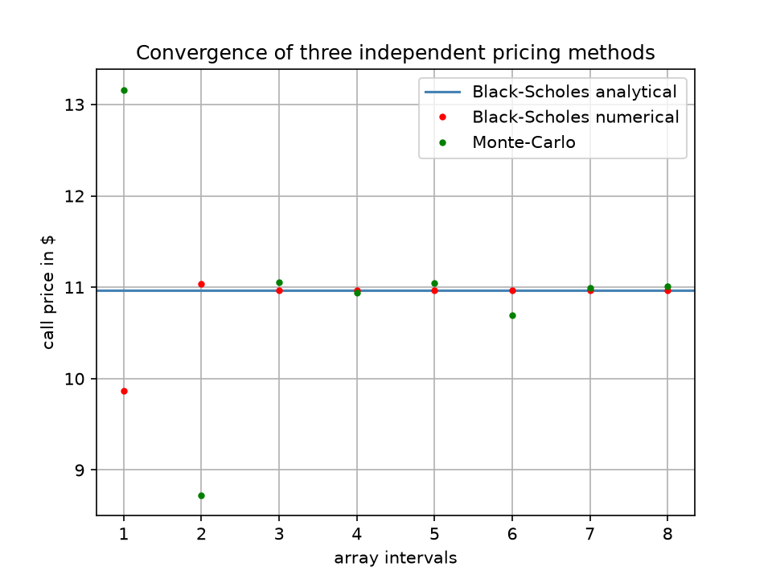
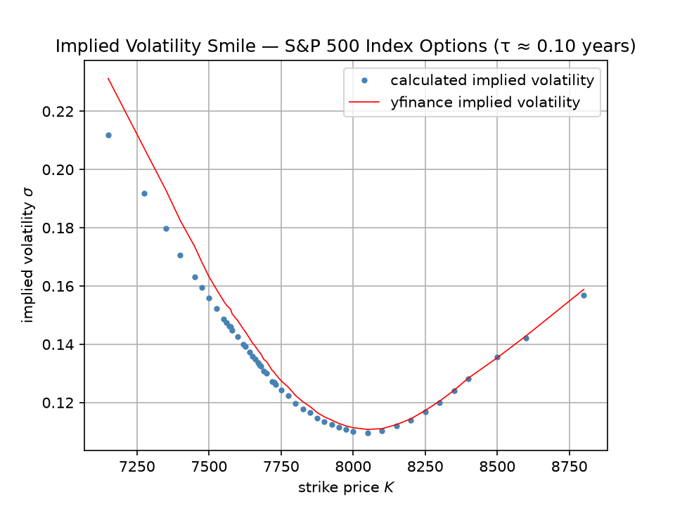

# Options Pricing Engine: From Heat Diffusion to Black-Scholes

I am currently a physics student and this is my take on quantitative finance. Applying what I have learned about solving differential equations in my studies to the pricing of options.

> Learning project — **not financial or investment advice**.

## Motivation

The Black-Scholes PDE

```
∂V/∂t + ½σ²S²∂²V/∂S² + rS∂V/∂S − rV = 0
```

is, after a substitution of variables, mathematically identical to the classical heat/diffusion
equation

```
∂u/∂τ = ∂²u/∂x²
```

familiar from physics. This project is built around that connection: three
different ways of solving the same pricing problem. A closed-form solution, a stochastic
simulation, and a numerical PDE solver. These are implemented independently and compared against
each other, and finally against real option prices from the market.

## Methods implemented

| Method | File | Approach |
|---|---|---|
| **Analytical** | `black_scholes.py` | Closed-form Black-Scholes formula (with continuous dividend yield `q`) + all major Greeks (Delta, Gamma, Vega, Theta, Rho) |
| **Monte Carlo** | `monte_carlo.py` | Fully vectorized simulation of geometric Brownian motion paths; price estimated as the discounted mean payoff |
| **Finite Differences** | `finite_dif.py` | Explicit finite-difference scheme solving the Black-Scholes PDE directly on an (S, t) grid, with bilinear interpolation for off-grid queries |
| **Implied Volatility** | `implied_vol.py`, `market_data.py` | Real option chains fetched via `yfinance`, implied volatility recovered per strike via root-finding (Brent's method), plotted as a volatility smile |

## Project structure

```
quant-finance-options-pricer/
├── src/
│   ├── black_scholes.py      # Analytical formula + Greeks (supports dividend yield q)
│   ├── monte_carlo.py        # Vectorized GBM simulation, path plotting
│   ├── finite_dif.py         # Explicit finite-difference PDE solver
│   ├── market_data.py        # Option chain retrieval via yfinance
│   └── implied_vol.py        # Implied volatility via root-finding + smile plot
├── tests/
│   └── tests.py              # Convergence studies & comparison plots
├── notebooks/
│   └── notebook01.ipynb      # Exploration, plots, worked examples
├── requirements.txt
└── README.md
```

## Key results



- **Monte Carlo vs. Black-Scholes** (`mc_bs_conv`): the simulated call price converges to the
  analytical price as the number of simulated paths grows, with the absolute error shrinking
  roughly as expected for a Monte Carlo estimator.
- **Finite Differences vs. Black-Scholes** (`fd_bs_conv`): the explicit scheme converges to the
  analytical price as the grid is refined. The scheme is run with `N = M²` time steps, directly
  reflecting the stability condition derived for the explicit method (see below).
- **All three methods together** (`fd_mc_bs`): plotted on the same axes, all three approaches
  converge to the same call price, confirming that the Monte Carlo simulation, the PDE
  discretization, and the closed-form solution are all consistent with one another.
- **Volatility smile** (`plot_volatility_smile`): implied volatilities recovered from real SPX
  index option prices closely reproduce the volatility smile reported by the data provider,
  after filtering out illiquid quotes (see below).


## Numerical stability of the explicit finite-difference scheme

The explicit scheme is only conditionally stable. A von Neumann stability analysis of the
diffusion term `½σ²S²·∂²V/∂S²` (the term responsible for the numerical instability, independent
of the drift and discounting terms) gives the condition

```
Δt ≲ (ΔS)² / (σ² S_max²)
```

i.e. the time step must shrink quadratically as the grid is refined in space. `fd_bs_conv` and
`fd_mc_bs` choose `N = M²` for exactly this reason.

## Market data pipeline



Implied volatilities are computed from **S&P 500 index options (`^SPX`)** rather than
single-stock options. This is a deliberate choice: SPX index options are cash-settled and
European-style by contract specification, matching the assumptions of the Black-Scholes model
used throughout this project. Single-stock options in the US are typically American-style,
which would require a different (and generally more expensive) pricing model.

For a chosen target time-to-expiry, the pipeline:
1. Selects the available expiry date closest to the target maturity.
2. Retrieves the call option chain and filters out illiquid quotes (`volume > 0`,
   `openInterest > 5`, `bid > 0`) to avoid stale or effectively worthless contracts skewing the
   result.
3. Uses the bid-ask midpoint as the market price for each strike.
4. Recovers the implied volatility per strike via Brent's root-finding method, using the
   project's own `black_scholes_call` and comparing the result against the implied volatility
   reported by the data provider as a validation check.

## Known simplifications

- **Dividend yield `q`** is implemented in the analytical Black-Scholes formula (and therefore in
  the implied volatility pipeline), but **not yet** in the Monte Carlo or finite-difference
  solvers, which currently assume `q = 0`. The three-method comparison plots (`fd_mc_bs`,
  `mc_bs_conv`) are therefore run with `q = 0` throughout for consistency. Extending Monte Carlo
  and finite differences to a non-zero `q` only requires replacing the drift's `r` with `r − q`.
- **Risk-free rate `r` and dividend yield `q`** are supplied as fixed, estimated inputs rather
  than derived from market data. This introduces a small, systematic
  bias in the recovered implied volatilities, most visible for options far from the money.
- **Day-count convention**: time to expiry is computed as calendar days divided by 365.
- **Finite-difference scheme**: only the explicit scheme is implemented. An implicit or
  Crank-Nicolson scheme would remove the stability restriction on `Δt` at the cost of solving a
  tridiagonal linear system at every time step. I might add it in the future though.

## Setup

```bash
git clone https://github.com/pw06/quant-finance-options-pricer.git
cd quant-finance-options-pricer
python3 -m venv venv
source venv/bin/activate
pip install -r requirements.txt
```

## Possible extensions

- Extend `q` support to Monte Carlo and finite differences
- Derive `r − q` from market data via put-call parity instead of estimating it
- Implicit / Crank-Nicolson finite-difference scheme
- American options 
- Stochastic volatility (Heston)

## Background

Physics student with an interest in the overlap between physics, numerical methods, and
quantitative finance. This project grew out of using the heat-equation analogy as an entry
point into option pricing theory, stochastic calculus, and numerical PDE methods.
